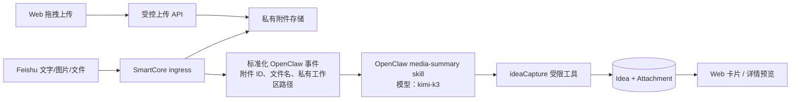

# Idea 富媒体输入：需求与方案设计

状态：已确认重构范围；实施前不部署。历史 Idea 不保留，发布前仅做灾备备份。

## 目标与验收标准

1. 飞书的文字、图片、文件（PDF/TXT/ZIP）统一进入 OpenClaw。事件处理器只负责鉴权、下载、受控存储、路由与确认回执，**不调用 OCR、不直接创建 Idea**。
2. OpenClaw 的媒体提炼任务固定使用中转站的 `kimi-k3`（与普通日程对话模型隔离）。它读取附件和附言，输出一个不超过 80 字标题及不超过 500 字的中文 Markdown 说明；不可确认的信息明确标注，不编造。
3. Agent 通过受限的 `ideaCapture` 工具一次写入标题、说明和附件 ID；附件原文件保留且可在工作台预览/下载。图片保存后可灯箱放大，文档可下载；ZIP 不解压、不执行。
4. Web 工作台可新建“标题 + Markdown 说明 + 多附件”，支持点击和拖拽 PNG/JPEG/WebP、PDF、TXT、ZIP；上传图片/PDF 后异步请求同一媒体提炼能力并建议填充说明，用户仍可编辑后保存。
5. 中栏卡片只显示标题、两行摘要、创建时间、标签和附件计数；右栏展示完整 Markdown、安全附件预览和“转待办 / 归档 / 删除”动作。所有读取、上传、预览、删除均按当前登录用户隔离。

非目标：本期不做 Office 文档在线渲染、不从 ZIP 中抽取内容、不保存外部可公开访问的原始飞书 URL、不自动把灵感转成日程。

## 当前问题

现网的图片路径是 `Feishu -> 下载资源 -> deepseek-ocr-2 -> 直接 createIdea`。这会丢失原图，OCR 失败会阻塞输入，且绕过 OpenClaw 的上下文、统一提炼和用户回执。当前 `idea.content` 同时承担标题、正文和摘要，`mediaPath` 只能放一个无结构路径，无法表达多附件。

## 架构



### 模型与 Skill 边界

- 新增 `smartcore-media-summary` skill，只接受本事件提供的附件路径；禁止扫描工作区、读取 `.env`、数据库或其他用户文件。
- Adapter 为媒体事件显式选择 `OPENCLAW_MEDIA_MODEL=kimi-k3`，并在运行命令/会话元数据中固定该模型。普通文字日程沿用现有模型配置。
- 该 skill 产出结构化 JSON：`{title, description, tags}`；Adapter 将其作为 Agent 上下文，Agent 只需调用 `ideaCapture`。如果 Kimi 调用或附件读取失败，返回简短失败原因并保留已存的“待处理附件草稿”，不伪造摘要。
- 飞书图片不再调用 `deepseek-ocr-2`；`VISION_MODEL` 可保留给其他独立功能，待线上观察期后再清理。

## 数据模型与迁移

最终模型遵循主从关系，并将临时上传与正式附件分离，避免让正式外键出现空值：

```text
idea(
  ideaId PK, userId FK, title, description, content_legacy,
  srcType, handled, createdAt
)
ideaAttachment(
  attachmentId PK, ideaId FK NOT NULL ON DELETE CASCADE,
  fileName, mimeType, storageKey, sizeBytes, createdAt
)
ideaUpload(
  uploadId PK, userId FK, fileName, mimeType, storageKey,
  sizeBytes, expiresAt, createdAt
)
```

- 不保留 `content`、`mediaPath` 或旧 Idea 请求字段。新 API 只使用 `title`、`description`、`attachmentIds`。
- 发布迁移先对生产数据库建立独立压缩备份，随后删除旧 `idea` 数据并重建 Idea 相关表；不回填历史记录。
- 新增 `ideaAttachment`，`ideaId NOT NULL` 且级联删除；不允许未绑定附件进入该表。
- 新增 `ideaUpload` 仅用于前端两阶段上传，绑定 `userId`、短期过期。创建 Idea 时在同一事务中验证上传归属、创建附件行、删除 upload 行。定时清理过期的上传记录和未关联文件。
- 飞书附件没有前端暂存阶段：先写入私有文件，OpenClaw 调用 `ideaCapture` 时由 `sourceMessageId` 绑定并在同一事务中创建正式附件。重复消息由现有 `msgLog.externalId` 幂等保护。

## API 合约

| API | 权限 | 关键请求 / 返回 |
|---|---|---|
| `POST /api/idea/uploads` | 登录用户 | multipart `files[]`；返回受用户绑定、15 分钟有效的 upload 元数据 |
| `POST /api/idea/media-summary` | 登录用户 | `uploadIds[]`、caption；异步提炼，返回建议的 `title/description/tags`，不自动落库 |
| `POST /api/idea` | 登录用户 | `{title, description, uploadIds, srcType}`；原子创建 Idea 和附件 |
| `GET /api/idea` | 登录用户 | Idea 列表，含精简附件元数据和受鉴权的 `downloadUrl` |
| `GET /api/idea/{id}` | 所有者 | 完整详情 |
| `GET /api/idea/attachments/{id}` | 所有者 | 图片 inline；其他附件 attachment 下载；路径不暴露 |
| `PATCH /api/idea/{id}` | 所有者 | 标题、说明、处理状态、标签（若本期启用） |
| `DELETE /api/idea/{id}` | 所有者 | 事务删除记录，文件进入可恢复回收区后异步清理 |
| `POST /agent/idea/capture` | 有效事件 scope | `{title, description, attachmentRefs, srcType:"media"}`；scope 用户与附件所有者必须匹配 |

`attachmentRefs` 只能是本次事件在 Adapter 注入的不可猜测引用，Agent 不能任意提交服务器路径或 URL。

## 存储、鉴权与安全

- 使用 Docker 命名卷 `smartcore-idea-media`：应用挂载为 `/app/data/idea_media`，Adapter 只读挂载为 `/attachments`；不能经 Caddy 或静态目录直接访问。
- 文件名只用于展示；实际文件名使用 UUID/哈希 storageKey。拒绝路径分隔符、SVG/HTML/可执行文件；允许 JPG/JPEG/PNG/WebP、PDF、TXT、ZIP。单文件 20 MB、单次最多 10 个、总量 50 MB。
- MIME 类型以服务端白名单和文件头复核为准，下载时设置 `Content-Disposition` 和 `X-Content-Type-Options: nosniff`。图片只允许浏览器安全格式；PDF 用 `attachment` 下载，避免内嵌脚本风险。
- 所有附件读取须通过 Idea 所有者校验；Agent scope 只允许绑定用户和绑定聊天的本事件附件；日志只记录 ID、大小、类型和结果，不记录文件内容、scope 或提示词原文。
- 删除采用“数据库级级联 + 文件移入回收区”的可恢复策略，7 天后后台清理。

## 前端交互

- 左/中栏 `IdeaCard`：标题、两行 description（CSS line clamp）、附件徽标、标签、时间，点击即选中。
- 右上详情：Markdown 采用受控渲染（禁 raw HTML）；图片缩略图点击打开灯箱；文档以图标、名称、大小、下载按钮显示。
- 右下表单：标题一行、说明 Markdown textarea、拖拽区、文件列表、移除按钮、“AI 提炼并填充”按钮、保存按钮。上传不等于保存 Idea；离开页面时提示尚未保存的附件将自动过期。
- 空/错误状态：上传类型或大小不合规、Kimi 失败、附件失效、网络中断均有可恢复提示；用户可不使用 AI，手工保存。

## 发布、回滚与验证

1. 先在 dev 数据库运行可重复重建，验证旧 Idea 表被明确替换、附件外键正确建立。
2. 后端单测：迁移、跨用户越权、上传白名单、幂等飞书事件、附件原子绑定、Agent scope 归属、Kimi 失败保留草稿。
3. 前端测试：拖拽上传、卡片截断/徽标、详情图片/文档、手工编辑、AI 建议填充、无障碍键盘关闭灯箱；执行 `npm run type-check && npm test && npm run build`。
4. 集成测试：模拟飞书 image/file/post，多附件经 Adapter→Kimi skill→ideaCapture 后只有一个 Idea 且附件可读；验证普通文字日程路径未受影响。
5. 部署前执行生产 SQLite 备份，先 dev 部署并冒烟；生产只通过既有 promote 脚本。健康检查、运行 revision、受权用户预览和一条无害的端到端测试均通过后才宣布完成。
6. 回滚应用镜像到上一个 revision；数据重构不具备在线数据回滚，若要恢复旧 Idea 仅可从部署前备份人工恢复。若需停用媒体功能，关闭入口与 Adapter media skill，已有附件仍可读取。

## 待确认项

1. 模型标识确认使用 `kimi-k3`；Adapter 将新增 `OPENCLAW_MEDIA_MODEL=kimi-k3`。
2. PDF 默认安全下载，本期不做在线阅读。
3. 标签本期仅由 Kimi 生成并在 API 返回；持久化多对多标签表留待后续迭代。
